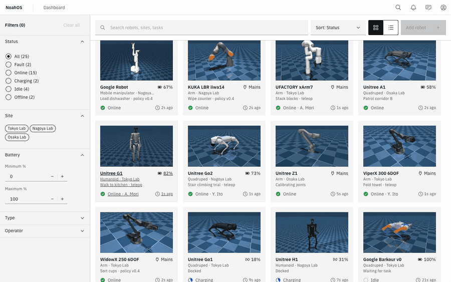
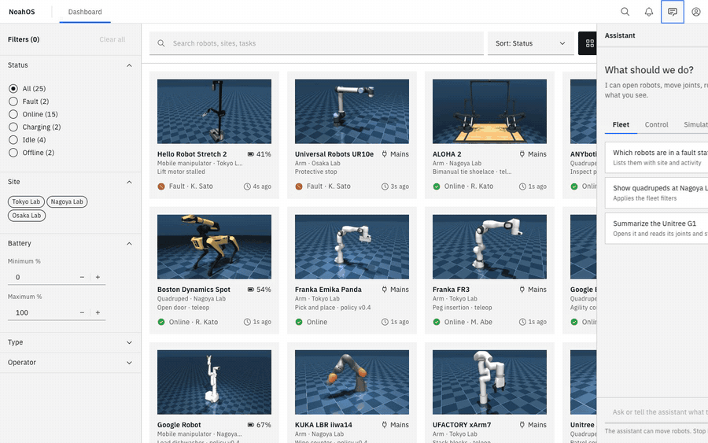
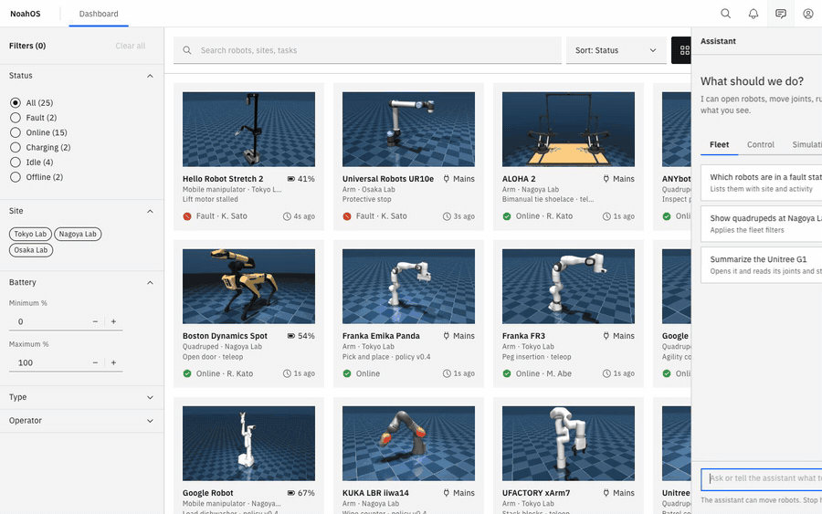
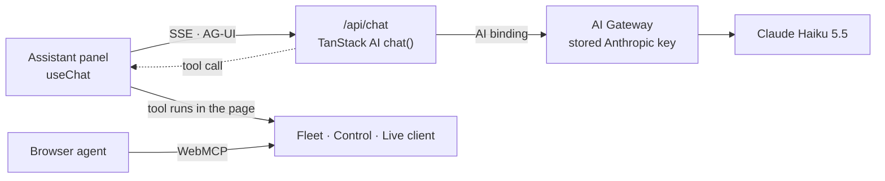
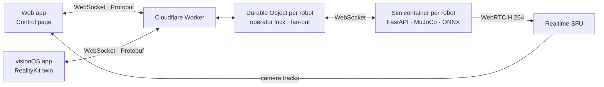

# NoahOS

NoahOS is an operating console for a fleet of robots. A web dashboard lists every robot. Each robot's Control page shows a 3D twin you can pose joint by joint. **Live view** connects that page to a MuJoCo physics simulation of the robot: the sim streams joint telemetry and camera video back, runs learned policies such as a walking gait, and accepts joint commands from the operator. A visionOS app puts the same live twin in your room on Apple Vision Pro, paired with the Control page in Safari.

The fleet is 25 robots from [MuJoCo Menagerie](https://github.com/google-deepmind/mujoco_menagerie): humanoids, quadrupeds, arms and mobile manipulators.

Not deployed at the moment; [run it locally](#run-it-locally). The Cloudflare configuration is in `apps/web/wrangler.jsonc`, and the console asks you to create an account (email and password, activated by an emailed link).

## Web app



The fleet dashboard filters robots by status, site, battery, type and operator. On a robot's Control page you click a part of the 3D model and turn its joint with the wheel or the XY pad. You can also drag a limb with inverse kinematics, undo and redo, and see the centre of gravity, mass moved and gravity torque. A joint that reaches its limit turns red.

- **Framework:** TanStack Start (React 19, server-side rendering) on Vite, with IBM Carbon components.
- **3D:** three.js. The robot's MJCF file is parsed in the browser and built into a scene.
- **Live client:** one binary WebSocket carrying Protobuf messages (`@bufbuild/protobuf`). Telemetry is applied to the twin on each animation frame, and joint commands are coalesced to at most 60 Hz.
- **Edge:** a Cloudflare Worker serves the app. A Durable Object per robot (`RobotSession`) holds the operator lock, fans telemetry out to every viewer and starts that robot's sim session: through the local Docker orchestrator (`SIM_UPSTREAM`) in development, or a Cloudflare Container once deployed.
- **Accounts:** better-auth on Cloudflare D1, with activation and password-reset emails sent through Cloudflare Email Service. `/app` and, in production, the live relay require a session.
- **Tests:** vitest for state and live statistics, Playwright for the live end-to-end flow.

## Simulation

Each live robot runs in its own simulation session. Live view starts in Manual hold, where the operator moves joints and the sim drives them with its position servos. **Play** on a policy in the Policies panel hands the joints to that policy until **Pause**; **Stop** is an emergency stop that freezes the pose and is open to every role.

- **Service:** Python 3.12 with FastAPI. An orchestrator starts one process per robot session.
- **Physics:** MuJoCo 3 at the model's own timestep (500 Hz for most robots), with Menagerie models patched with cameras and a base hold.
- **Policies:** *Joint sweep* moves every actuated joint through ±25 % of its range. *Joystick walk* runs the Go1 and G1 locomotion policies from [MuJoCo Playground](https://github.com/google-deepmind/mujoco_playground) with ONNX Runtime.
- **Telemetry, 60 Hz:** joint positions, velocities, torques, power, a thermal model of each motor, battery, contacts, and sim stats (step time, real-time factor, CPU).
- **Cameras:** rendered off-screen and published as H.264 over WebRTC (aiortc) to Cloudflare Realtime SFU, which fans them out to browsers.
- **Recording and tools:** episodes recorded to MCAP, and a Foxglove WebSocket bridge for ROS-style tools.
- **Robot config:** `apps/sim/robots.yaml`. **Deployment:** Docker locally; in production each robot's sim runs in a Cloudflare Container started by its Durable Object, publishing cameras through Cloudflare TURN.

## visionOS app

The visionOS app lists the fleet and opens a robot as a volumetric window, showing a RealityKit twin you can scale to fit the volume or to life size. **Open Control page** opens that robot's Control page in Safari with the app's pair token in the URL. The relay gives a client whose token matches the lock holder's the operator role as well, so the headset and the browser act as one operator. Joints you turn in Safari move the twin in the room, and you can pinch and drag a part of the twin to move it from the headset.

- **App:** SwiftUI and RealityKit for visionOS 2. The Xcode project is generated with XcodeGen from `apps/vision/project.yml`.
- **Live client:** `URLSessionWebSocketTask` with SwiftProtobuf, speaking the same contract as the web app.
- **Models:** USDZ files exported from the MuJoCo models (`apps/sim/scripts/export_usdz.py`) and served by the web app at `/api/robots`, cached on the device.

## AI assistant

An assistant panel on every page runs the console from plain language. It is Claude Haiku 5.5, and it acts through tools that drive the same UI you click: it filters the fleet, opens robots, moves joints, changes the view, goes live, plays and pauses policies, stops robots and opens cameras. Each reply shows its work: a collapsible **Thinking** row with the model's reasoning, each tool call as a step with its input and result, then a short answer.






**How it is built**

- **Chat:** [TanStack AI](https://tanstack.com/ai). The panel (`useChat`) streams from `POST /api/chat`, a TanStack Start server route on the Worker that runs `chat()` with the Anthropic adapter and adaptive thinking.
- **Model access:** the Worker's Workers AI binding sends each Messages request to **Cloudflare AI Gateway**, which holds the Anthropic key as a stored provider key. The Worker has no Anthropic secret, and the gateway logs every request with tokens and cost.
- **Tools run in the browser:** 19 tool definitions (zod schemas) are shared by the server, which hands them to the model, and the browser, which executes them. Each page registers a capability while it is mounted: the fleet dashboard its filters, the Control page its twin, view and live client, and the landing page its demo video. A tool navigates when it needs another page, waits for that page's capability (and, on a Control page, for the robot's model to load), then acts and returns `{ ok, … }` or a reason the model can explain.
- **WebMCP:** the same tools are registered with `document.modelContext`, so a browser agent can drive the console without the chat.
- **Safety:** the assistant has no back door. Joint moves and policies go through the live client and relay, which enforce the operator role and Manual hold. Stop is never a model round trip: while the open robot is live, the panel header shows a one-click Stop. Only signed-in users can chat, in production only, with per-user limits of 20 messages and 120 tool steps a minute.



Code: `apps/web/src/lib/agent/` (tools, registry, joint matching), `apps/web/src/components/assistant/` (panel), `apps/web/src/server/assistant.server.ts` and `apps/web/src/routes/api/chat.ts`.

## How it fits together



One Protobuf schema, `proto/noahos/sim/v1/sim.proto`, defines every message. `buf` generates the TypeScript, Python, Swift and Go code (Go is used by the load generator in `tools/loadgen`). The generated code is committed. [STACK.md](STACK.md) covers the design in detail: transport choices, latency budget, security model and deployment.

## Run it locally

Requires Docker, Node with pnpm, and [uv](https://docs.astral.sh/uv/) for the sim's Python tools.

```sh
# 1. Simulation service on :8000
cd apps/sim && cp .env.example .env && docker compose up --build

# 2. Web app on :3000 (in another terminal)
pnpm install
cd apps/web && cp .dev.vars.example .dev.vars
pnpm models:fetch          # download the Menagerie models
pnpm d1:migrate:local      # create the local accounts database
pnpm dev                   # open http://localhost:3000/app
```

`/app` asks you to sign in. Create an account; locally no email is sent, and the dev server log prints the activation link (`{"event":"auth-email",…,"url":…}`). Open it to finish signing up.

Camera streams need a Cloudflare Realtime app ID and secret in both env files. Without them, everything else works.

**visionOS app:** run `pnpm models:usdz` in `apps/web` to export the twins. Start the web app with `pnpm dev --host` so the headset can reach it. Then run `xcodegen` in `apps/vision`, open `NoahOS.xcodeproj`, run on Apple Vision Pro or the simulator, and set the server URL to `http://<your-mac-ip>:3000`.

## Repository layout

| Path | What |
| --- | --- |
| `apps/web` | Web app, Worker and Durable Object |
| `apps/sim` | Simulation orchestrator, sessions, policies, USDZ export |
| `apps/vision` | visionOS app |
| `proto` | Protobuf contract |
| `tools/loadgen` | Go load generator for fan-out latency |

## Credits

Robot models: [MuJoCo Menagerie](https://github.com/google-deepmind/mujoco_menagerie). Locomotion policies: [MuJoCo Playground](https://github.com/google-deepmind/mujoco_playground), Apache License 2.0 (see `apps/sim/src/noahos_sim/policies/onnx/NOTICE`).
